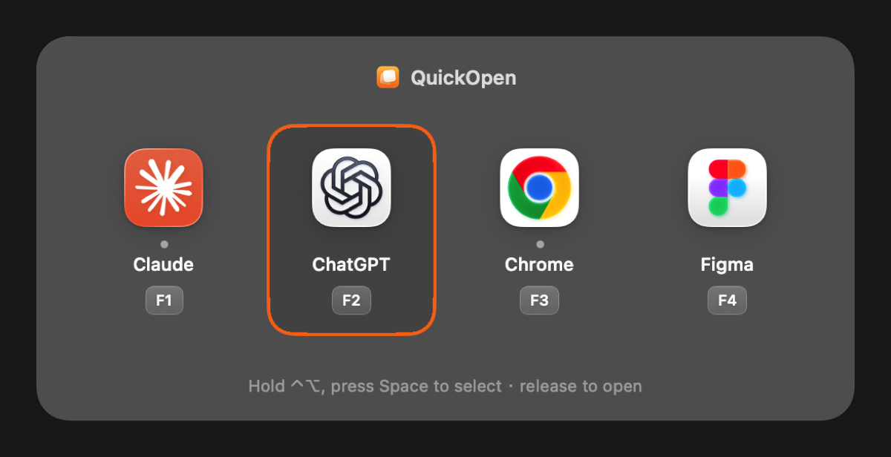
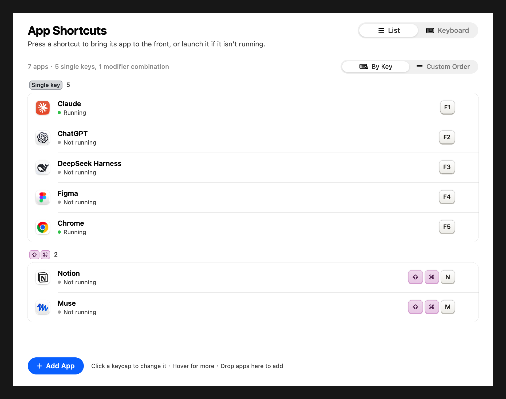
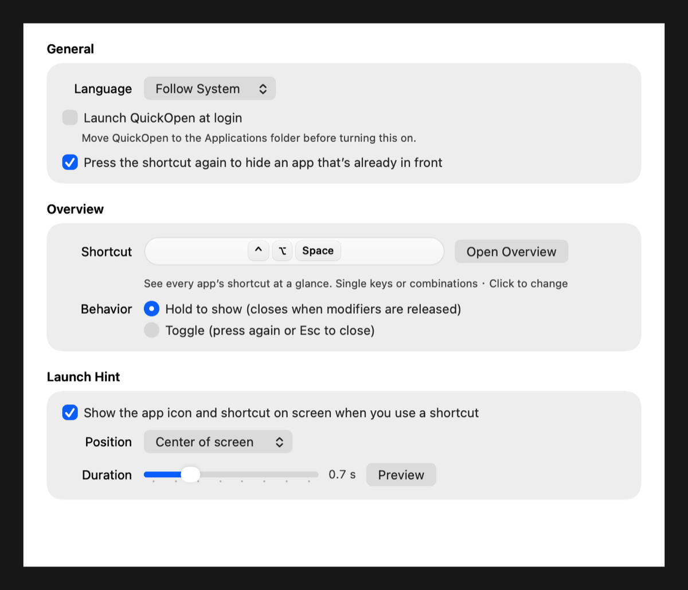
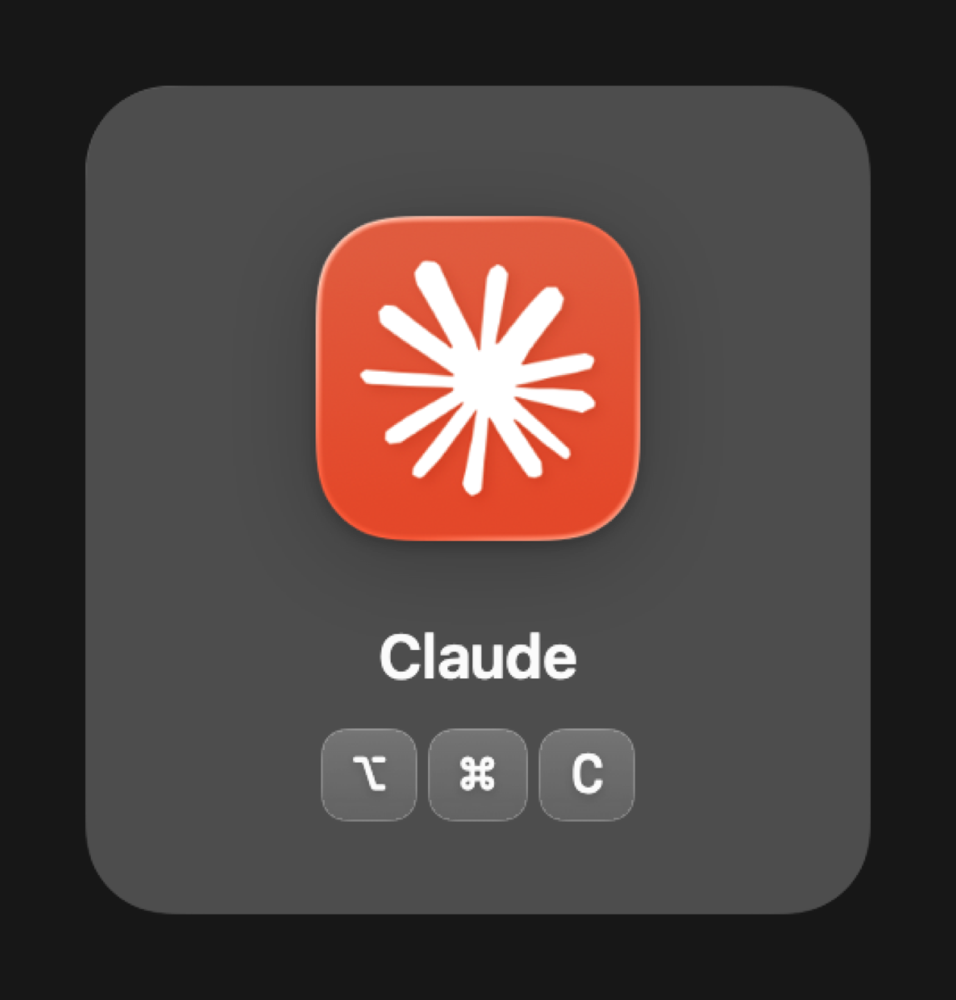

<p align="center">
  
</p>

<h1 align="center">QuickOpen</h1>

<p align="center">
  Launch or switch to any Mac app with a single global shortcut.<br>
  A tiny, native menu bar utility — no Accessibility permission required.
</p>

<p align="center">
  <b>English</b> · <a href="README.zh-CN.md">简体中文</a>
</p>

<p align="center">
  <a href="../../releases/latest"></a>
  <a href="../../actions/workflows/ci.yml"></a>
  
  <a href="LICENSE"></a>
</p>

---

## Features

- **One key, one app.** Bind a global shortcut to any `.app` — a combination like `⌥⌘S` or a single key like `F5`.
  - Running? It comes to the front (and opens a window if it has none).
  - Not running? It launches.
  - Already in front? Press again to hide it (optional).
- **Shortcut overview.** Press `⌃⌥Space` to see every app and its shortcut in a grid at the center of the screen, just like `⌘Tab`.
  - *Hold mode* (default): hold `⌃⌥`, tap `Space` to move the selection, release to open (or close if nothing is selected).
  - *Toggle mode*: press once to show, again or `Esc` to hide; arrow keys select, `↩` opens.
  - Or simply press any app's shortcut, or click its icon.
- **Launch hint.** Each time you use a shortcut, the app's icon and keys flash briefly on screen, so shortcuts stick in your memory. Position and duration are adjustable.
- **Liquid Glass UI** on macOS 26, with a graceful fallback on macOS 13–15. Follows light/dark mode.
- **English and Simplified Chinese.** Follows your system language by default; switch in Settings → General.
- **Thoughtful details:** conflict detection, warnings for shortcuts taken by other apps, drag to reorder, drag apps in from Finder, launch at login.
- **Private and light:** no Accessibility permission, no network access, no third-party dependencies. Pure AppKit + Carbon, about 1 MB.

> **About Input Monitoring.** App shortcuts work without any permission. Only the overview's *Hold* mode asks once for **Input Monitoring**, so it can reliably notice when you release `⌃⌥` no matter which app has focus. QuickOpen only listens to modifier-key changes while the overview is on screen and never records what you type. Without it, Hold mode still works but may occasionally wait for a mouse move; *Toggle* mode never needs it.

<p align="center">
  
</p>

<details>
<summary>More screenshots</summary>

| Shortcuts | General |
|---|---|
|  |  |

<p align="center"></p>

</details>

## Install

1. Download `QuickOpen-<version>.dmg` from the [latest release](../../releases/latest).
2. Open it and drag **QuickOpen** into **Applications**.
3. First launch: builds that are not notarized need a right-click on QuickOpen → **Open** (only once).
   Alternatively run:
   ```bash
   xattr -dr com.apple.quarantine /Applications/QuickOpen.app
   ```

Requires macOS 13 Ventura or later, on Apple Silicon or Intel.

## Usage

1. Open QuickOpen. Its icon appears in the menu bar.
2. Click **Add App…** (or drag apps into the window).
3. Press the shortcut you want to bind. Press `Esc` to cancel or `Delete` to clear.
4. Press that shortcut anywhere to bring up the app.

Tips:

- Single letter or number keys work, but they will be captured system-wide (you won't be able to type that character). Function keys (`F1`–`F20`) are a safe choice for single-key shortcuts.
- Settings → **General** lets you change the language, the overview shortcut and mode, the launch hint, hide-on-repeat, and launch at login.
- Shortcuts are stored in `~/Library/Application Support/QuickOpen/shortcuts.json`. If the file is ever unreadable, it is backed up as `shortcuts.corrupted-<time>.json` instead of being overwritten.

## Build from source

Requires Xcode 26 (Swift 6) for the Liquid Glass APIs.

```bash
git clone https://github.com/simmzl/QuickOpen.git
cd QuickOpen
swift test                 # run tests
./scripts/build-app.sh     # → dist/QuickOpen.app (universal)
./scripts/build-dmg.sh     # → dist/QuickOpen-<version>.dmg / .zip / .sha256
```

Useful environment variables for the build scripts:

| Variable | Purpose |
|---|---|
| `QUICKOPEN_VERSION` | Version to stamp into the app, e.g. `1.4.0` |
| `QUICKOPEN_ARCHS` | Architectures, default `arm64 x86_64` |
| `QUICKOPEN_SIGNING_IDENTITY` | `codesign` identity; defaults to a *Developer ID Application* certificate if present, otherwise ad-hoc |
| `QUICKOPEN_NOTARY_PROFILE` | `notarytool` keychain profile, enables notarization |
| `QUICKOPEN_SKIP_ICON=1` | Use the committed icon instead of regenerating it |

Layout screenshots of the main views can be rendered with:

```bash
QUICKOPEN_SNAPSHOT_DIR=/tmp/quickopen-shots swift test --filter SnapshotTests
```

README screenshots (English and Chinese) are generated with:

```bash
QUICKOPEN_README_IMAGES=1 QUICKOPEN_SNAPSHOT_DIR=/tmp/qo swift test --filter testRenderReadmeImages
```

## Releasing

Releases are fully automated by GitHub Actions:

1. Add a section for the new version to [CHANGELOG.md](CHANGELOG.md).
2. Tag and push:
   ```bash
   git tag v1.4.0
   git push origin v1.4.0
   ```
3. The [Release workflow](.github/workflows/release.yml) runs the tests, builds a universal app, packages a `.dmg` and `.zip` with SHA-256 checksums, and publishes a GitHub Release whose notes come from the changelog. Tags with a suffix (e.g. `v1.4.0-beta.1`) become pre-releases.

**Signing and notarization (optional).** Without extra configuration the release is ad-hoc signed. To ship a Developer ID–signed and notarized build, add these repository secrets:

| Secret | Value |
|---|---|
| `MACOS_CERTIFICATE_P12` | Base64 of your *Developer ID Application* certificate exported as `.p12` |
| `MACOS_CERTIFICATE_PASSWORD` | Password of the `.p12` |
| `NOTARY_KEY_P8` | Base64 of an App Store Connect API key (`.p8`) |
| `NOTARY_KEY_ID` | The API key ID |
| `NOTARY_ISSUER_ID` | The API issuer ID |

## How it works

- Global shortcuts use Carbon's `RegisterEventHotKey`, which does not require Accessibility or Input Monitoring permission.
- Like `⌘Tab`, QuickOpen briefly becomes the active app while the overview is visible and hands activation straight to the chosen app.
- In Hold mode, a listen-only event tap (`CGEventTap`, modifier changes only) detects the release of `⌃⌥`. It exists only while the overview is visible.
- Apps are activated through `NSWorkspace.openApplication`, which behaves like clicking the Dock icon.

## Contributing

Issues and pull requests are welcome. Please run `swift test` before submitting.

## License

[MIT](LICENSE) © Simmzl
