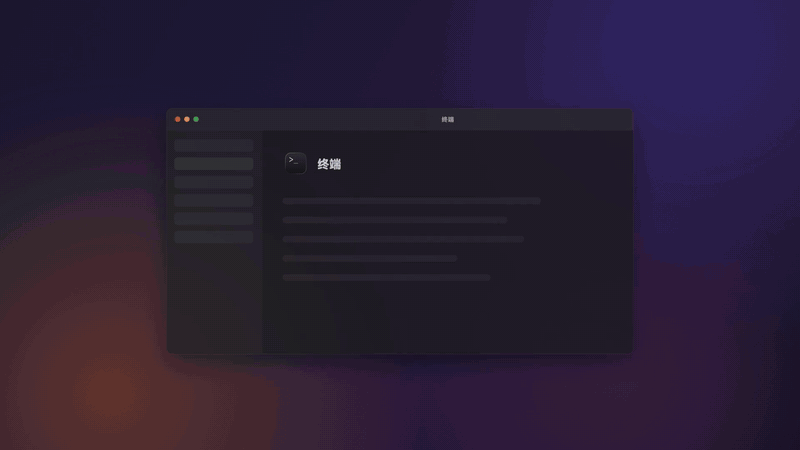
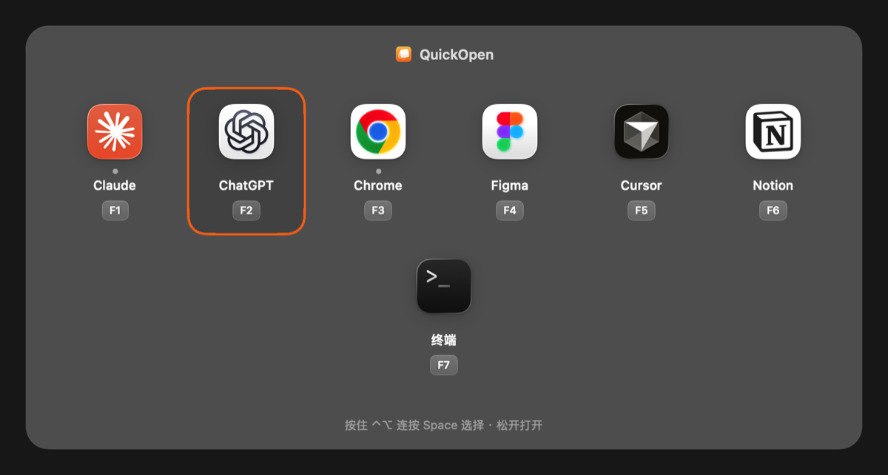
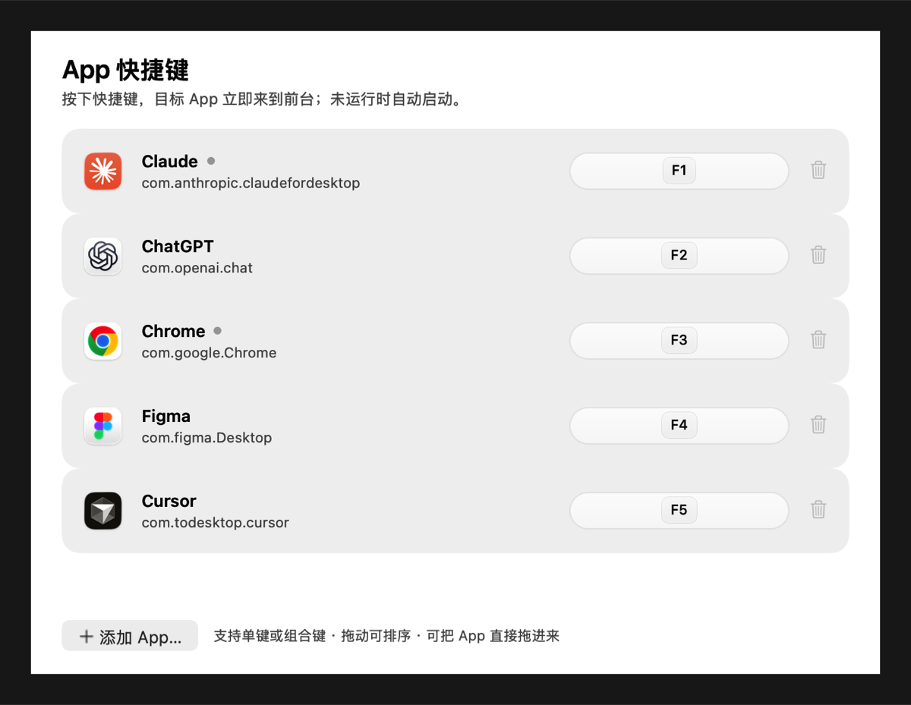
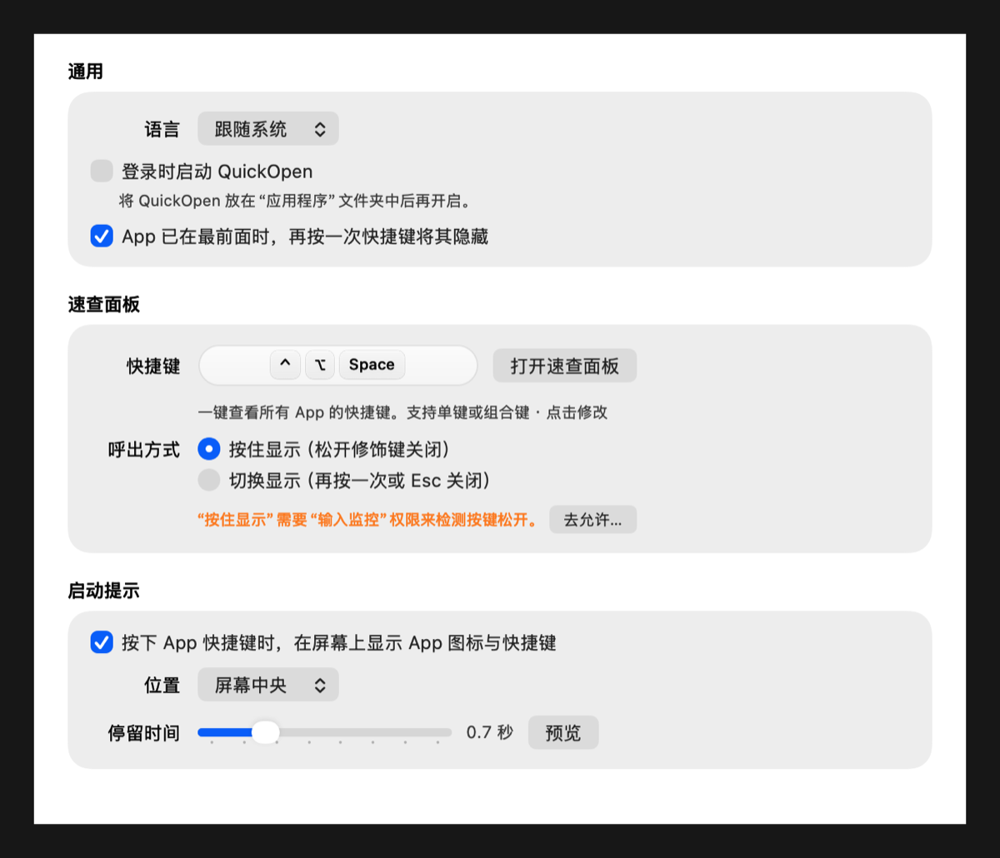
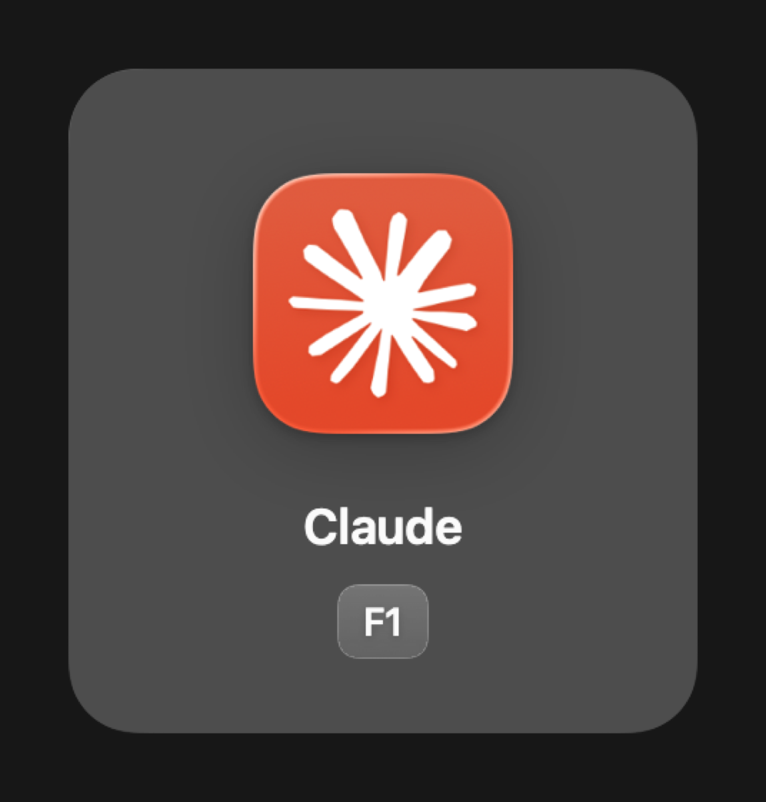

<p align="center">
  
</p>

<h1 align="center">QuickOpen</h1>

<p align="center">
  一个全局快捷键，直接打开或切换到任意 Mac App。<br>
  原生、轻量的菜单栏小工具，无需“辅助功能”权限。
</p>

<p align="center">
  <a href="README.md">English</a> · <b>简体中文</b>
</p>

<p align="center">
  <a href="../../releases/latest"></a>
  <a href="../../actions/workflows/ci.yml"></a>
  
  <a href="LICENSE"></a>
</p>

---

<p align="center">
  
  <br>
  <sub><a href="docs/media/demo-zh.mp4">观看高清版（MP4）</a></sub>
</p>

## 功能

- **一个键，一个 App。** 给任意 `.app` 绑定全局快捷键，可以是 `⌥⌘S` 这样的组合键，也可以是 `F5` 这样的单键。
  - 已在运行：立即切到前台；没有窗口时会新开一个。
  - 没有运行：自动启动。
  - 已在最前面：再按一次可以隐藏（可在设置中关闭）。
- **速查面板。** 按 `⌃⌥Space`，屏幕中央以网格显示所有 App 和对应的快捷键，就像 `⌘Tab`。
  - **按住显示**（默认）：按住 `⌃⌥`，连按 `Space` 切换选中项，松开即打开；没有选中时松开则关闭。
  - **切换显示**：按一次显示，再按一次或按 `Esc` 关闭；方向键选择，`↩` 打开。
  - 也可以直接按某个 App 的快捷键，或者点击它的图标。
- **启动提示。** 每次按快捷键时，屏幕上会短暂显示这个 App 的图标和快捷键，帮你记住它们。位置和停留时间可调。
- **液态玻璃界面。** 在 macOS 26 上使用系统液态玻璃，macOS 13–15 自动降级为磨砂效果；跟随浅色、深色模式。
- **中英双语。** 默认跟随系统语言，也可在「设置 › 通用」中切换。
- **细节完善：** 快捷键冲突检测、被其他 App 占用时提示、拖动排序、从访达直接拖入 App、登录时启动。
- **私密轻量：** 不需要辅助功能权限，不联网，没有第三方依赖。纯 AppKit + Carbon，约 1 MB。

> **关于“输入监控”权限。** App 快捷键不需要任何权限。只有速查面板的“按住显示”会请求一次 **输入监控** 权限，用来在任何 App 处于前台时都能可靠地检测到 `⌃⌥` 被松开。QuickOpen 只在面板显示期间监听修饰键的变化，不记录任何输入内容。不授权时“按住显示”仍可使用，但偶尔需要动一下鼠标才会打开；“切换显示”完全不需要这个权限。

<p align="center">
  
</p>

<details>
<summary>更多截图</summary>

| 快捷键 | 通用 |
|---|---|
|  |  |

<p align="center"></p>

</details>

## 安装

1. 在 [最新版本](../../releases/latest) 页面下载 `QuickOpen-<版本号>.dmg`。
2. 打开后，把 **QuickOpen** 拖进“应用程序”。
3. 首次打开：未经公证的版本需要在“应用程序”里右键点 QuickOpen →「打开」，只需一次。
   也可以在终端运行：
   ```bash
   xattr -dr com.apple.quarantine /Applications/QuickOpen.app
   ```

需要 macOS 13 Ventura 或更新版本，支持 Apple 芯片和 Intel 芯片。

## 使用

1. 打开 QuickOpen，菜单栏会出现它的图标。
2. 点击「添加 App…」，或者直接把 App 拖进窗口。
3. 按下要绑定的快捷键。按 `Esc` 取消，按 `Delete` 清除。
4. 之后在任何地方按这个快捷键，就能呼出对应的 App。

小提示：

- 可以用单个字母或数字作快捷键，但这个键会在所有 App 中被拦截，无法再正常输入。单键推荐用 `F1`–`F20`。
- 「设置 › 通用」中可以切换界面语言，修改速查面板的快捷键和呼出方式、启动提示、再按一次隐藏、登录时启动。
- 快捷键保存在 `~/Library/Application Support/QuickOpen/shortcuts.json`。如果文件损坏无法读取，会备份为 `shortcuts.corrupted-<时间>.json`，不会被覆盖。

## 从源码构建

需要 Xcode 26（Swift 6），以使用液态玻璃相关 API。

```bash
git clone https://github.com/simmzl/QuickOpen.git
cd QuickOpen
swift test                 # 运行测试
./scripts/build-app.sh     # → dist/QuickOpen.app（通用二进制）
./scripts/build-dmg.sh     # → dist/QuickOpen-<版本号>.dmg / .zip / .sha256
```

构建脚本支持的环境变量：

| 变量 | 作用 |
|---|---|
| `QUICKOPEN_VERSION` | 写入 App 的版本号，例如 `1.4.0` |
| `QUICKOPEN_ARCHS` | 构建的架构，默认 `arm64 x86_64` |
| `QUICKOPEN_SIGNING_IDENTITY` | `codesign` 签名身份；有 *Developer ID Application* 证书时默认使用它，否则临时签名 |
| `QUICKOPEN_NOTARY_PROFILE` | `notarytool` 钥匙串配置名，设置后会进行公证 |
| `QUICKOPEN_SKIP_ICON=1` | 使用仓库中已提交的图标，不重新生成 |

渲染主要界面的布局截图：

```bash
QUICKOPEN_SNAPSHOT_DIR=/tmp/quickopen-shots swift test --filter SnapshotTests
```

README 中的中英文截图由以下命令生成：

```bash
QUICKOPEN_README_IMAGES=1 QUICKOPEN_SNAPSHOT_DIR=/tmp/qo swift test --filter testRenderReadmeImages
```

演示视频由 App 真实的界面组件渲染生成，不需要录屏：

```bash
QUICKOPEN_DEMO_DIR=/tmp/qo-demo swift test --filter DemoVideoTests   # → demo-en.mp4、demo-zh.mp4
```

## 发布

发布由 GitHub Actions 全自动完成：

1. 在 [CHANGELOG.md](CHANGELOG.md) 中为新版本写一段更新说明。
2. 打标签并推送：
   ```bash
   git tag v1.4.0
   git push origin v1.4.0
   ```
3. [Release 工作流](.github/workflows/release.yml) 会运行测试、构建通用二进制、打包 `.dmg` 和 `.zip` 并生成 SHA-256 校验和，然后发布 GitHub Release，更新说明取自 CHANGELOG。带后缀的标签（如 `v1.4.0-beta.1`）会发布为预发布版本。

**签名与公证（可选）。** 不做额外配置时，发布的版本为临时签名。如需使用 Developer ID 签名并经 Apple 公证，请在仓库中添加以下 Secrets：

| Secret | 内容 |
|---|---|
| `MACOS_CERTIFICATE_P12` | 导出为 `.p12` 的 *Developer ID Application* 证书，Base64 编码 |
| `MACOS_CERTIFICATE_PASSWORD` | `.p12` 的密码 |
| `NOTARY_KEY_P8` | App Store Connect API 密钥（`.p8`），Base64 编码 |
| `NOTARY_KEY_ID` | API 密钥 ID |
| `NOTARY_ISSUER_ID` | API Issuer ID |

## 实现原理

- 全局快捷键使用 Carbon 的 `RegisterEventHotKey`，不需要“辅助功能”或“输入监控”权限。
- “按住显示”通过只读的事件监听（`CGEventTap`，只关注修饰键变化）检测 `⌃⌥` 的松开，仅在速查面板显示期间存在。
- 和 `⌘Tab` 一样，速查面板显示期间 QuickOpen 会短暂成为前台 App，随即把前台直接交给选中的 App。
- 通过 `NSWorkspace.openApplication` 激活 App，效果等同点击 Dock 图标。

## 参与贡献

欢迎提交 Issue 和 Pull Request。提交前请先运行 `swift test`。

## 许可证

[MIT](LICENSE) © Simmzl
